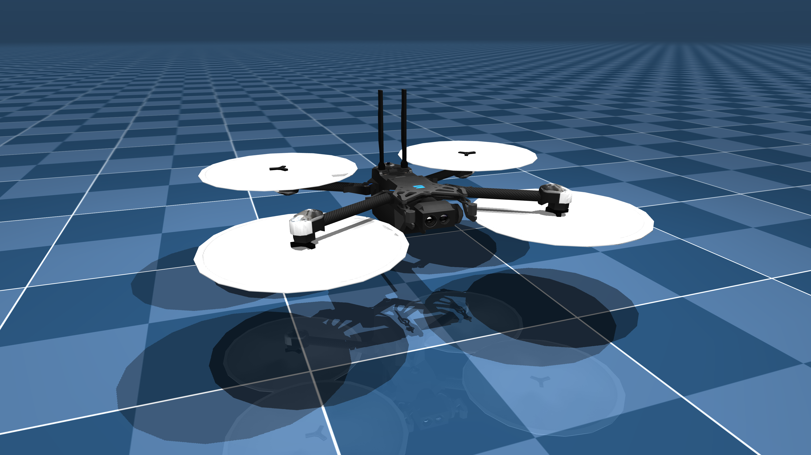

# Updates:
None yet

# Submission format

**You should submit via moodle before the deadline.**

Before submitting, go through the list below and make sure you took care of all of the requirements.
More details can be found in the detailed task description.
**If you do not comply with these regulations you can be penalized up to obtaining zero points for the task**.

1. Submit a zipped file with only the two following files inside:
- `drone_control.py`
- `pid.py`
2. Do not submit files with simulation conditions changed
3. You are required to use PID control, but it's your task to choose a proper design, i.e. the number and type of PID controllers
4. The simulation should not crash at any stage.
5. You should modify only the places in the code which have the `TODO` tags.
6. You should not read any values from mujoco simulation.
All you need is provided by the functions and variables in the `DroneSimulator` class.

# Requirements

See `pyproject.toml` and `uv.lock`.

From this directory, run `uv run drone_control.py`.

On macOS, MuJoCo's `mjpython` launcher can fail to find `libpython` with a Python downloaded by uv.
In that case, you can try to use Python installed from [python.org](https://www.python.org/downloads/macos/) or Homebrew.
For a python.org installation, run:

```bash
uv run --python /Library/Frameworks/Python.framework/Versions/3.11/bin/python3.11 mjpython drone_control.py
```

Replace the interpreter path if your Python is installed elsewhere, and keep `--python` on subsequent runs.
uv prepares `.venv` and installs the locked dependencies automatically.
No separate sync or activation is needed.

# Problem Description

## Overview

You will design PID-based control to fly the Skydio drone through gates under four environment variants:
wind on/off and rotated gates on/off.
Code contains TODO markers intentionally left for you;
only fill those sections in `pid.py` and `drone_control.py`.
The example solution video shows all four variants on the fixed track at real-time
speed, with an overview of the course in the inset:

<video width="724" controls>
  <source src="assets/images/example-solution-low-res.mp4" type="video/mp4">
  Your browser does not support the video tag.
</video>


## Assets

### Skydio X2

We use a simplified robot description (MJCF) of the [Skydio X2](https://www.skydio.com/skydio-x2) drone developed by [Skydio](https://www.skydio.com/).
The model and necessary assets were downloaded from [mujoco_menagerie](https://github.com/google-deepmind/mujoco_menagerie).
Rotor gears were slightly changed to allow yaw control.

{: width="400" }

### Drone Simulator

Except the assets from Skydio, you are given a `drone_simulator.py` script.
Your submission must not rely on editting this script as it will not be a part of your submission.

Inside the script you can find the definition of a `DroneSimulator` class.
It contains attributes and methods to run a simulated flight of a drone.

To complete the tasks you have to understand:

1. how initialisation parameters work,
2. how roll, pitch and yaw thrusts work,
3. how to get the sensor readings from an instance,
4. how wind is simulated.

#### Drone Simulator instance

Assuming that a `DroneSimulation` was instantiated in the following way:

```python
drone_simulator = DroneSimulator(model, data, viewer, rendering_freq = 1)
```

the `model`, `data` and `viewer` arguments refer to MuJoCo functionalities,
you should read about them in the [MuJoCo documentation](https://mujoco.readthedocs.io/en/stable/overview.html).
They are already prepared for you in the stub files.

`rendering_freq` allows you to display the simulation faster.
Remember, as discussed during the lecture, that this does not affect the simulation results!
Hence it allows you to run debugging tests more quickly or slow down the simulation to analyse your current results in more detail.

#### Roll, Pitch, Yaw and Thrust

Note: You do not have to understand the physics in detail to complete the task.
Description below is just here to help you.
Feel free to ask questions about these concepts during the lab sessions if something is not clear.

By changing thrust on specific rotors we can change the orientation of the drone.
Check [this video](https://youtu.be/pQ24NtnaLl8?si=PQUBFI-UdfGFejr0) to understand how the roll, pitch and yaw angles are defined.

Roll and pitch are quite easy to understand.
For example, by increasing the thrust at the rotors in the back of the drone we can pitch the drone.
If at the same time we will decrease the thrust at the front,
the effect will be even bigger and we will keep the average thrust unchanged at the same time.
The roll thrust works in a similar manner.

Yaw angle is a little bit more complicated -
by changing the thrust on diagonal rotors we can affect the average torque on the drone
(think of a rotational force).
This allows as to rotate the drone around z axis in the drone coordinate frame.

Here's the part of the code which implements these thrust inputs (additionally, random values representing gusts of wind have been added to thrusts):


```python
self.data.actuator("thrust1").ctrl = thrust + roll_thrust - pitch_thrust - yaw_thrust + self.wind1
self.data.actuator("thrust2").ctrl = thrust - roll_thrust - pitch_thrust + yaw_thrust + self.wind2
self.data.actuator("thrust3").ctrl = thrust - roll_thrust + pitch_thrust - yaw_thrust + self.wind3
self.data.actuator("thrust4").ctrl = thrust + roll_thrust + pitch_thrust + yaw_thrust + self.wind4
```


#### Sensors

Assuming that an instance of the `DroneSimulation` class was stored in a `drone_simulator` variable,
you can get:
 - the last two registered `[x, y, z]` positions of the drone with `drone_simulator.position_sensor()`
 - the last two registered `[roll, pitch, yaw]` orientations with `drone_simulator.orientation_sensor()`

The calls to these methods are already present in the stub file `drone_control.py`.

Both sensors provide you with a new reading in each simulation timestep.

#### Summary

This is all you should need to implement the control for the drone.
If you want to understand the `DroneSimulation` class better, you are always encouraged to go through the class definition.

## Task

1. Implement the PID controller in `pid.py` (respect types and output limits).
2. In `drone_control.py`, complete the TODO sections to tune controllers and waypoint logic so the drone:
   - reaches the final target without crashing,
   - tracks gates in all four variants (wind on/off, rotated gates on/off).

Avoid:
 - hitting the gates
 - unstable drone behaviours

# References and Licenses

The [Skydio X2](https://www.skydio.com/skydio-x2) model is released under an [Apache-2.0 License](https://github.com/google-deepmind/mujoco_menagerie/blob/main/skydio_x2/LICENSE). Compared to the original model, only one camera has been changed and a second one has been added.
