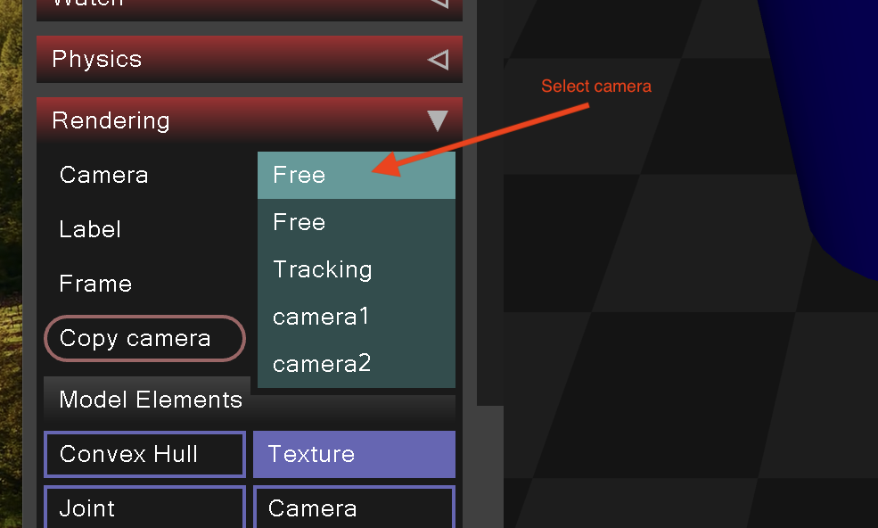
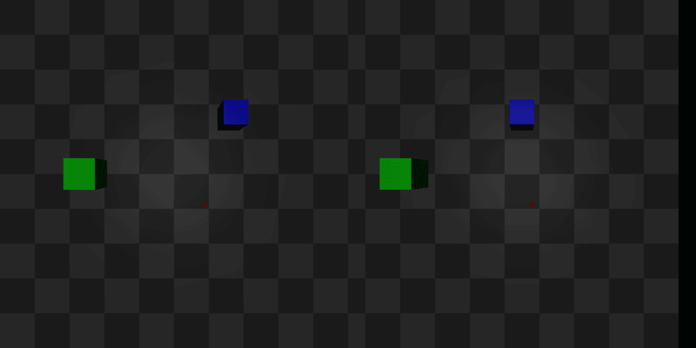

Today's lab consists of two parts: Colab and the MuJoCo simulator.

# Colab

Access the Colab notebook: [lab3-colab](https://colab.research.google.com/github/mim-ml-teaching/public-rc-2026-27/blob/refs/heads/main/docs/lab3-public/cv_notebook/lab3-colab-student.ipynb).


# MuJoCo

For this part, you'll be working with the following MuJoCo XML world:


```xml
<mujoco model="simple_scene">
    <option timestep="0.005" gravity="0 0 -9.81"/>

    <asset>
        <texture name="plane_texture" type="2d" builtin="checker" rgb1="0.2 0.2 0.2" rgb2="0.3 0.3 0.3" width="512" height="512"/>
        <material name="plane_material" texture="plane_texture" texrepeat="5 5" reflectance="0"/>
    </asset>

    <worldbody>
        <geom type="plane" size="1 1 0.1" material="plane_material"/>

        <body pos="0 0 0.5">
            <geom type="box" size="0.1 0.1 0.1" rgba="0.8 0 0 1"/>
        </body>

        <body pos="0.2 0 0.5">
            <geom type="sphere" size="0.1" rgba="0 0.8 0 1"/>
        </body>

        <body pos="-0.2 0 0.5">
            <geom type="cylinder" size="0.1 0.15" rgba="0 0 0.8 1"/>
        </body>

        <!-- Cameras -->
        <camera name="camera1" pos="0 -0.1 1" fovy="90"/>
        <camera name="camera2" pos="0 0.1 1" fovy="90"/>
    </worldbody>
</mujoco>
```

This XML code defines a simple scene with a plane, a box, a sphere, a cylinder, and two cameras. Familiarize yourself with the XML structure and understand the role of each element.

## Visualizing the Scene
An environment managed by `uv` is already defined in the `mujoco/pyproject.toml` file.

Open the MuJoCo simulator to view the scene. Pay attention to the XML structure and how each element contributes to the visual scene. Also, note that two cameras ("camera1" and "camera2") are specified in the XML.



The image above demonstrates how you can select the desired camera view within the simulator.

## Tasks

### 1. Changing camera parameters
We want to get a better understanding of how cameras work in MuJoCo.
The best way to achieve this is to play around with various parameters defining the camera.
Refer to the [MuJoCo documentation on cameras](https://mujoco.readthedocs.io/en/stable/XMLreference.html#body-camera) for guidance and modify the XML to:

 - rotate the camera.
 - change the `fovy` parameter to see how it affects the image.
 - remove the `fovy` parameter and define the camera using the parameter `focal` instead.

In the last subtask, you had to define additional parameters such as `sensorsize`. Try changing this parameter to see how it impacts the resulting view.

### 2. Adding new objects
Add a very small red ball (so small that it's barely visible) to the scene and change the color of the red box to something else.
In the next task, we will need this to distinguish between the red ball and everything else in the world.

### 3. Object detection
Write a program that finds the pixel position of the center of the red ball you have created in the previous task.
You can use the following code to generate pictures from a MuJoCo camera:

```python
import mujoco
from PIL import Image

xml_path = "a.xml"
model = mujoco.MjModel.from_xml_string(open(xml_path).read())
renderer = mujoco.Renderer(model, 1024, 1024)
data = mujoco.MjData(model)
mujoco.mj_forward(model, data)
renderer.update_scene(data, camera="camera1")
img = Image.fromarray(renderer.render())
img.save("red_ball.png")
```
Remember that OpenCV uses BGR by default, not RGB.

### 4. Stereo matching
Your task is to implement your own depth detection using stereo matching.
Assuming you've downloaded the repo from GitHub, you can find the script `stereo_vision.py` in the `mujoco/` directory, and two images, `left.png` and `right.png`, in `mujoco/assets/`.
The script `stereo_vision.py` was used to generate the views from two cameras (`left.png`, `right.png`) of a world with two boxes and one sphere.
Sadly, the information about the positions of the objects was lost.


Using all the information still available in `stereo_vision.py`
and your knowledge about stereo vision,
find the coordinates of the objects.
Finish the implementation of `stereo_vision.py` to reconstruct the views seen in `left.png` and `right.png`.
The objects should be in similar positions,
but don't worry if their positions are not exactly the same as in the original images.

Tips:
 - Start by finding the centers of the visible parts of the objects.
 - Remember that the center of the box and the center of its top face have slightly different `z` coordinates.
 - If you need a refresher about stereo vision, you can find it below.
 - You can use basic trigonometry to find a relation between the focal length `f` and the field-of-view parameter `fovy`: `f * tan(fovy / 2) = image_height / 2`.



## Stereo Vision Refresher

Stereo vision happens when you have access to more than one camera, e.g.:


Stereoscopic imaging allows calculating 3D coordinates without knowing anything about the geometry of the object or scene.
We can even do this with a single point (which will be demonstrated soon).
A stereo camera is an example of a depth camera,
because it can provide information about the depth of the scene.

### Depth calculation

<iframe id="stereo-depth" src="assets/stereo-depth-cameras.html" title="Interactive stereo depth geometry and live camera images" width="100%" height="1150" style="display: block; width: 100%; border: 0; border-radius: 12px;"></iframe>

<script>
(() => {
  const frame = document.getElementById('stereo-depth');
  window.addEventListener('message', event => {
    if (event.source !== frame.contentWindow || event.origin !== window.location.origin) return;
    const data = event.data;
    if (data && data.type === 'stereo-depth-resize' && Number.isFinite(data.height)
        && data.height >= 300 && data.height <= 4000) {
      frame.style.height = `${Math.ceil(data.height)}px`;
    }
  });
})();
</script>

[Open the interactive diagram separately](assets/stereo-depth-cameras.html). You can also save that HTML file and open it offline in a browser.

Quick explanation:

 - `P` is the point whose depth we want to estimate. Its horizontal position `X` is measured from the left camera, increasing to the right; its depth `Z` is the perpendicular distance to the line through the two camera pinholes.
 - The pinholes are labeled **Left camera** and **Right camera**. The baseline `B` is the distance between them. The cameras are parallel and have the same focal length.
 - The real image planes are behind the pinholes at distance `f` (the focal length). Rays from `P` pass through the pinholes and intersect these planes.
 - `O₁` and `O₂` are the image origins for the left and right cameras, respectively.
 - `x` and `x′` are the signed horizontal positions of the projections relative to `O₁` and `O₂`, respectively, increasing to the right. The rear image planes invert the projections: `x = -f * X / Z` and `x′ = -f * (X - B) / Z`. With the initial point position, `x` is negative.
 - The disparity is `d = x′ - x`. The **Image coordinates** strip aligns the two origins so that you can see this difference directly.
 - Move `P` or change `Z`, `X`, `B`, and `f` with the controls. The highlighted similar triangles have heights `Z` and `f`, and bases `B` and `d`.

From similar triangles:\
`B / Z = d / f = (x′ - x) / f` \
So:\
`Z = f * B / d = f * B / (x′ - x)`

Try using that formula in the code. Did it work? If not, why do you think that is?

Hint: MuJoCo is automating something for us. Do we really work with a pinhole camera?

### Dense stereo matching

The last thing that should be mentioned when talking about stereo vision is dense stereo matching,
i.e. it is possible to find the disparity not only for some known features like a corner of a marker,
but for every point in the image.
This is done by trying to match pixels or blocks of pixels from the left image in the right image at the same height, but shifted left.

There are some caveats here.
Matching algorithms are not always perfect and almost always require a lot of tuning and are very sensitive to parameters.
As you can see below, there is some noise in the detected depth map.
More on that [here](https://docs.opencv.org/4.8.0/dd/d53/tutorial_py_depthmap.html)


