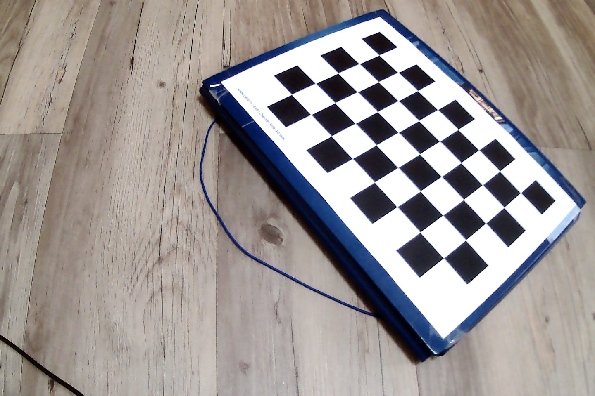
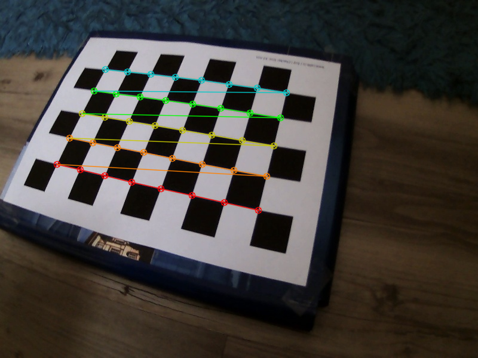
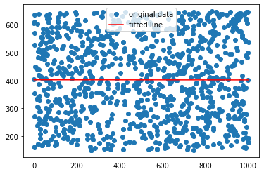
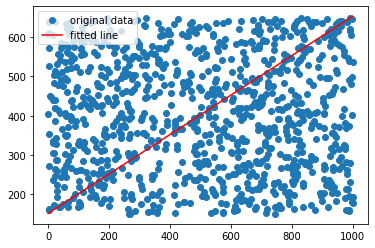
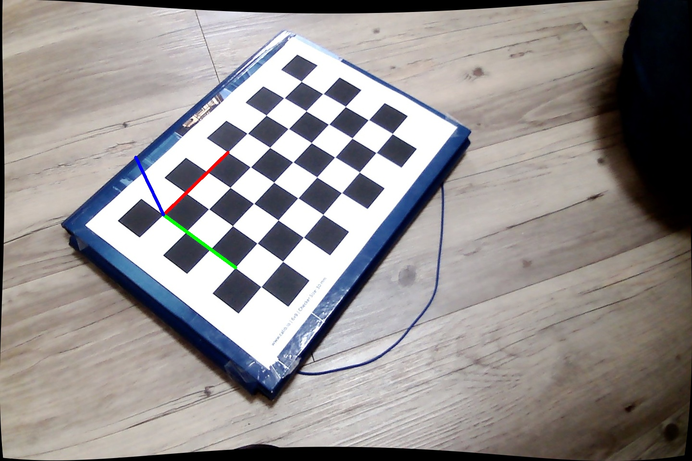
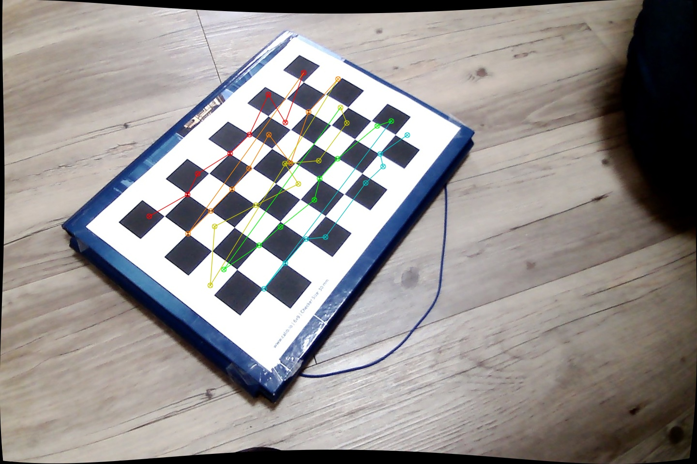
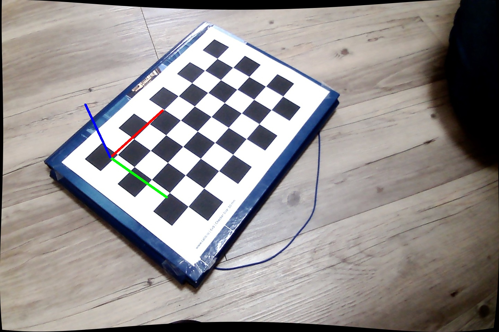

# Intro

During the lecture we introduced the pinhole camera model.
In the real world, cameras have lenses.
Intuitions about how the focal length and aperture influence depth of field are explained at length in the `Additional Materials` section on the [course website](https://mim-ml-teaching.github.io/public-rc-2026-27/), most notably in [this blog post](https://ciechanow.ski/cameras-and-lenses/).

# General info

During this lab we are going to calibrate the cameras based on the provided series of captured images.

This will be the first time we work with OpenCV only locally.
It should not be too different from the Colab notebook.
The main difference is that images are not displayed inline as in a notebook.
Instead, you can:

1. Save them to disk with `cv2.imwrite()`:

   ```python
   cv2.imwrite('chessboard_01.png', img)
   ```

2. Show them in an interactive window with `cv2.imshow()`.
   Remember to call `cv2.waitKey()` after every `cv2.imshow()`, otherwise the window will not be drawn:

   ```python
   cv2.imshow('chessboard', img)
   cv2.waitKey()  # waits for a key press; cv2.waitKey(1) waits only 1 ms
   cv2.destroyAllWindows()
   ```

   To close the window, click on it and press any key.

A uv environment with OpenCV and other libraries is provided.

# Distortions

Our camera introduces distortion to images. We will deal only with two types of distortion
during this lab:
- radial distortion
- tangential distortion

Radial distortion causes straight lines to appear curved.


Tangential distortion makes a "tilted" effect.


[This resource](https://docs.opencv.org/5.0/py_tutorials/py_calib3d/py_calibration/py_calibration.html) can be useful as a reference.

Our goal is to undistort a series of images and explore how undistorted image coordinates map to real-world 3D coordinates.

# Dataset

We have provided a dataset of images in the `data` folder. Take a look at the first image:



[Here](assets/calib_pattern.pdf) you can find a chessboard pattern that is used for calibration.

# Tasks

✅ **Finding the chessboard**

Write a program that takes a folder of images, finds a chessboard in every image, and either draws the chessboard or reports that it could not be found.

You will find the following functions helpful:

- [`cv2.findChessboardCorners`](https://docs.opencv.org/5.0/main_modules/objdetect_qrcode.html#findchessboardcorners) - finding chessboard corners (returns an array of corner coordinates as floats)
  - Please note that the `patternSize` parameter expects the number of inner corners between squares; for example, a 9x6 chessboard has 8x5 inner corners.
- [`cv2.cornerSubPix`](https://docs.opencv.org/5.0/main_modules/imgproc_feature.html#cornersubpix) - more exact corner positions
- [`cv2.drawChessboardCorners`](https://docs.opencv.org/5.0/main_modules/objdetect_qrcode.html#drawchessboardcorners) - drawing chessboard corners on the image


Function `cv2.cornerSubPix` expects five parameters:
- image — the image must be single-channel (convert with `cv2.cvtColor(img, cv2.COLOR_BGR2GRAY)`).
- corners — the corners detected by `cv2.findChessboardCorners`.
- winSize — half of the side length of the search window (we suggest `(11, 11)`).
- zeroZone — half of the size of the dead region in the middle of the search zone (we suggest `(-1, -1)` meaning no zone).
- criteria — termination criteria for the iterative corner refinement (we suggest `criteria = (cv2.TERM_CRITERIA_EPS + cv2.TERM_CRITERIA_MAX_ITER, 30, 0.001)`).

Example output:  



✅ **Camera calibration** 

Now we will expand the program to find:
- estimates of the rotation and translation vectors for the chessboard in every image
- intrinsic camera parameters together with the distortion coefficients

For that purpose, we will use the function
[`cv2.calibrateCamera`](https://docs.opencv.org/5.0/main_modules/calib.html#group-calib-1gac84adc7fe2e67780c366197cffa97ce8).
Let's have a closer look at the function parameters:
* `objectPoints` — array of arrays of object points in the object coordinate space (3D).
* `imagePoints` — array of arrays of corresponding image points (2D); in our case these are the corners found by `cv2.findChessboardCorners`.
* `imageSize` — size of the image (used to initialize the intrinsic camera matrix).
* `cameraMatrix, distCoeffs` — rough estimates of the camera matrix and distortion coefficients that we want to find. We don't have initial guesses, so set them both to `None`.

The core of the task is to provide the `objectPoints` parameter correctly.
For example, for a 4x5 chessboard with 30 mm squares the object points could be `(0,0,0), (30,0,0), (60,0,0), ..., (90,60,0)`.
In this example, the unit used for `objpoints` was millimetres.
Note that if we have a 4x5 chessboard, there are 3x4 inner corners between the squares.
For our 9x6 calibration chessboard you should therefore generate 8x5 = 40 object points.

Hints:
- `objpoints` should be of type `np.float32` (the default `np.float64` will not work).
- `np.mgrid()` is a useful NumPy helper you may want to use.


✅ **Undistort images**

Now that we have our camera calibrated we can undistort the images.
Your goal now is to write a program that reads images
and shows both distorted (original) and undistorted images side by side.

We could use
[`cv2.undistort`](https://docs.opencv.org/5.0/main_modules/imgproc_transform.html#undistort) to simply undistort the images.
However, it is much faster to compute the undistortion and rectification transformation map using
[`cv2.initUndistortRectifyMap`](https://docs.opencv.org/5.0/main_modules/imgproc_transform.html#initundistortrectifymap)
and then reuse these maps multiple times with
[`cv2.remap`](https://docs.opencv.org/5.0/main_modules/imgproc_transform.html#remap).

You can use the following values for some of the parameters of `cv2.initUndistortRectifyMap` and `cv2.remap`:

```python
R = np.eye(3), m1type=cv2.CV_32FC1, interpolation=cv2.INTER_LINEAR
```

Take a look at `cv2.initUndistortRectifyMap` documentation for mathematical details.
As a reminder from lab3, [`cv2.getOptimalNewCameraMatrix`](https://docs.opencv.org/5.0/main_modules/d_projection.html#getoptimalnewcameramatrix)
can be useful. Choose the `alpha` parameter depending on whether you want to retain all pixels or prefer a smaller field of view.


# RANSAC

Random sample consensus (RANSAC) is an iterative method which can be useful when one deals with a noisy data.
For example, when estimating a pose based on positions of features in the image.
[(According to wikipedia)](https://en.wikipedia.org/wiki/Random_sample_consensus),
RANSAC is an iterative method to estimate parameters of a mathematical model from a set of observed data that contains outliers,
when outliers are to be accorded no influence on the values of the estimates.
Let's look at an example to better understand what it actually means.

Consider an almost random 2D dataset:
- 5% of points come from an almost linear function,
- 95% are pure random noise

```python
import random
import matplotlib.pyplot as plt
from scipy import stats
import numpy as np

def value(alpha = 0.95):
    x = 1000 * random.random()
    y = 0.5 * x + random.gauss(0, 3) + 150
    if random.random() < alpha:
        y = random.uniform(150, 650)
    return x, y

values = [value() for _ in range(1000)]
values.sort()

x = np.array([v[0] for v in values])
y = np.array([v[1] for v in values])
res = stats.linregress(x, y)
plt.plot(x, y, 'o', label='original data')
plt.plot(x, res.intercept + res.slope*x, 'r', label='fitted line')
plt.legend()
plt.show()
```



As you can see, the linear regression found a line that tries to fit both the data and the noise.
Obviously, this is not a good fit.
The question is: can we do better?

Let's take a look at the RANSAC algorithm:

```
Given:
    data – A set of observations.
    model – A model to explain observed data points.
    n – Minimum number of data points required to estimate model parameters.
    k – Maximum number of iterations allowed in the algorithm.
    t – Threshold value to determine data points that are fit well by model.
    
Return:
    bestFit – model parameters which best fit the data (or null if no good model is found)

iterations = 0
bestPointCount = 0
bestFit = null

while iterations < k do
    maybeInliers := n randomly selected values from data
    maybeModel := model parameters fitted to maybeInliers
    alsoInliers := empty set
    for every point in data not in maybeInliers do
        if point fits maybeModel with an error smaller than t
             add point to alsoInliers
        end if
    end for
    if the number of elements in maybeInliers and alsoInliers is > bestPointCount then
        // This implies that we may have found a good model
        bestFit := model parameters fitted to all points in maybeInliers and alsoInliers
        bestPointCount := number of elements in maybeInliers and alsoInliers
    end if
    increment iterations
end while

return bestFit
```

We can try it with the following parameters:

* `k` - number of iterations set to `1000`
* `n` - number of elements in sample set to `2` (we need only two points to define a line!)
* `t` - threshold (squared distance) set to `10`

This is a result for the considered case:



As we can see the algorithm was able to deal with a dataset containing `95%` of outliers!

✅ **RANSAC with Linear Regression**

Write your own implementation of RANSAC and use it to find a better fit than standard linear regression.
Here's a general framework with TODOs to fill in:

```
best_diff = None
for k in range(100):
    sample = random.sample(values, 2)
    # TODO: perform linear regression based on the current sample
    # TODO: add datapoints to alsoInliers
    # TODO: calc how many points are in maybeInliers and alsoInliers
    # TODO: update the best model if needed
    # TODO: plot the results
```


# Pose estimation using solvePnP

Pose estimation is the task of estimating the rotation and translation vectors that transform a 3D point expressed in the object coordinate frame to the camera coordinate frame.
It uses the correspondence between the 3D point and its 2D representation in the image.
Here's more on [3D pose estimation](https://en.wikipedia.org/wiki/3D_pose_estimation).

[`cv2.solvePnP`](https://docs.opencv.org/5.0/main_modules/d_projection.html#solvepnp) is one of the OpenCV functions able to perform pose estimation.

It takes the following parameters:
* array of object points in the object coordinate space (3D)
* array of corresponding image points (2D)
* cameraMatrix estimated by `cv2.calibrateCamera`
* distCoeffs estimated by `cv2.calibrateCamera`

In fact, we already used `cv2.solvePnP` in lab3.
It was disguised as `my_estimatePoseSingleMarkers`, but it was actually `cv2.solvePnP` applied to the four corners of a marker.
    
At the beginning of this lab, we estimated the `cameraMatrix` and `distCoeffs` of the camera.
We can find the chessboard corners in the image using the `cv2.findChessboardCorners` function.
We also know the measurements of our chessboard, which will serve as the object.

✅ Using `cv2.solvePnP` and
[`cv2.projectPoints`](https://docs.opencv.org/5.0/main_modules/d_projection.html#group-d-projection-1ga1019495a2c8d1743ed5cc23fa0daff8c) (projects 3D points to 2D image, refer to lab3), write a program that draws a 3D coordinate system with (0,0,0) at a selected corner of the chessboard.
Use the RGB convention for the axes, i.e.: X (red), Y (green) and Z (blue). See the image below:



You can use the following code for drawing axes:
```python
def coordinates(point):
    return [int(i) for i in tuple(point.ravel())]

def draw(img, corners, imgpts):
    # WARNING: OpenCV uses BGR color space
    corner = coordinates(corners[0].ravel())
    img = cv2.line(img, corner, coordinates(imgpts[0]), (0,0,255), 5)
    img = cv2.line(img, corner, coordinates(imgpts[1]), (0,255,0), 5)
    img = cv2.line(img, corner, coordinates(imgpts[2]), (255,0,0), 5)
    return img
```

Use the images from the `data` directory to test your code.

# Noisy data

Often the detected data points may be noisy.
This can lead to poor results in pose estimation like in the image below:





✅ **RANSAC + solvePNP**

1. Make the output of `cv2.findChessboardCorners` noisy by adding some artificial noise.
   For example, select a few points.
   Slightly disturb some of them and replace the rest with pure random noise.
2. Check (visually) how `cv2.solvePnP` works on noisy data.
3. Implement an augmented version of `cv2.solvePnP` which uses RANSAC to deal with the outliers.
   You can use `cv2.solvePnP`, but the RANSAC implementation should be yours.

✅ **RANSAC + solvePNP - OpenCV implementation**

Compare your results with [`cv2.solvePnPRansac`](https://docs.opencv.org/5.0/main_modules/d_projection.html#solvepnpransac). Check:
- accuracy (either visually or by comparing against the original, undisturbed data)
- running speed
- different RANSAC parameters
