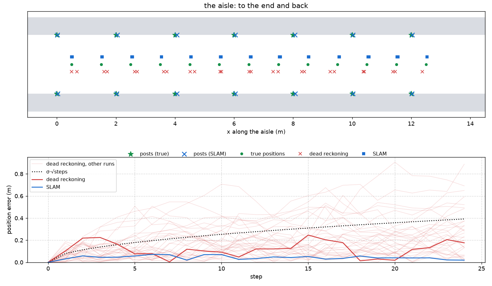
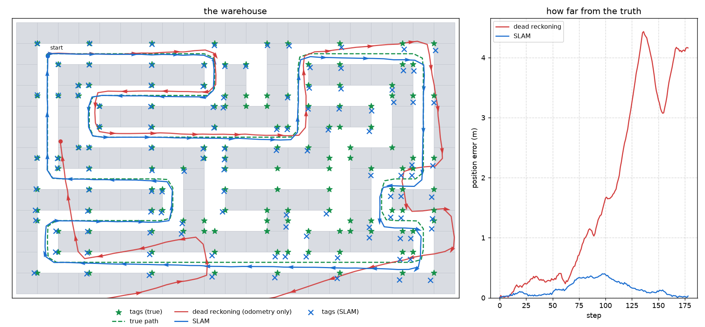
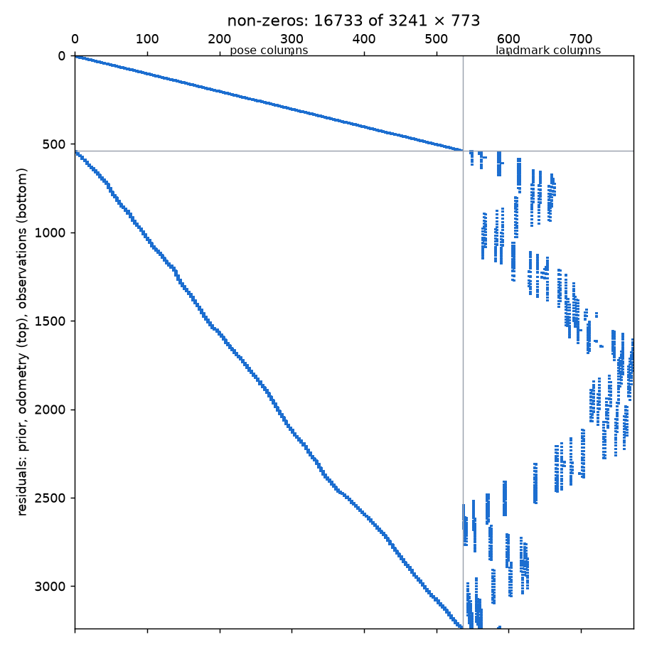

# SLAM in a warehouse

A robot works in a warehouse it has no map of.
To do its job it needs two things: a map of the shelves, and its own position on that map.
Neither is known.
Estimating both at once, from noisy measurements, is SLAM: Simultaneous Localisation And Mapping.

The lecture gave the recipe:

1. For every measurement, write down what it should be given the unknowns, subtract what it was: a residual.
2. Divide each residual by the noise of its measurement, square, sum: the cost.
3. Linearise, solve, move, iterate: least squares.

We first tackle a 1D case where we focus on one aisle.
Then we do SLAM in the entire werehouse, where the robot also turns.

## Setup

```
uv sync
uv run slam1d.py
uv run slam2d.py
```

Both scripts stop with `NotImplementedError` until you fill in the `TODO` blocks.
Both also have a `--play` mode that works at every stage:

```
uv run slam1d.py --play
uv run slam2d.py --play
```

It replays the drive step by step (space plays and pauses, the arrow keys step, up and down change the speed) and shows whatever is implemented so far: the true drive and the sightings from the start, dead reckoning once `compose()` works, SLAM once the residuals do.
At every step, SLAM is re-estimated from the measurements up to that step, starting from the previous estimate: that is what an online SLAM system does.

The code is in `slam_core/`:

| file | what it is |
|---|---|
| `models.py` | the data types: a pose, an odometry measurement, an observation |
| `geometry.py` | the motion model and the sensor model, and one dead-reckoning step (**your task**) |
| `world.py` | the warehouse: shelves, aisles, tags, the patrol route |
| `frontend_1d.py`, `frontend_2d.py` | the frontend: simulates the robot and produces its measurements |
| `backend_1d.py`, `backend_2d.py` | the backend: estimates the poses and the map from the measurements (**your task**, both) |
| `visualization.py` | the plots |

A real SLAM system has the same two halves: a frontend that turns sensor data into measurements, and a backend that minimises the cost.
Here the frontend also simulates the world, so it knows the truth.
The backend never sees it; only the plots do.

## Part 1: one aisle

The robot drives down one aisle to the end and back, and logs its measurements every metre.
On both sides of the aisle stand the shelf posts, 2 m apart, each with a tag.
The robot measures two things, both noisy:

* **odometry**: how far it moved in the last step (from the wheels),
* **observations**: for every post within 2.5 m, how far ahead of the robot the post is, along the aisle (a camera sees the tag and knows where it is in the robot's frame; in 1D we keep the forward component).

The unknowns are the robot's position at every step, $x_0, \ldots, x_T$, and the position of every post along the aisle, $p_1, \ldots, p_K$.
The residuals, as in the lecture:

* prior: $x_0 - \bar{x}_0$, the robot knows where it started,
* odometry, one per step: $(x_{t} - x_{t-1}) - z_t$,
* observation, one per sighting: $(p_k - x_t) - z_{t,k}$,

each divided by its $\sigma$.
Both models are linear, so least squares finds the answer in one step.

**Task 1.** Read `slam_core/frontend_1d.py` (what is measured) and `slam_core/backend_1d.py` (how the unknowns are packed, the prior, the initial guess), then write the odometry and observation residuals in `AisleBackend.residuals()`.
The whole residual vector goes to `scipy.optimize.least_squares`, which does the linearise-solve-move-iterate.
Run `uv run slam1d.py`, then `uv run slam1d.py --play` and step through the drive: watch the posts appear where they are first seen and settle as more sightings come in.



Things to notice:

* **Dead reckoning** (adding up the odometry, nothing else) drifts.
  Every step adds an independent random error, so the error performs a random walk: its typical size grows like $\sigma \sqrt{t}$ (the dotted line), and nothing ever pulls it back.
  The faint lines are the same drive with other noise draws.
* **SLAM** stays within a few centimetres along the whole drive, and so do the posts.
  Each post is seen from several positions, and each position sees several posts: the measurements tie everything together.
  On the way back the robot sees the posts it saw on the way out: a loop closure, in one dimension.
* Compare the final cost with the number of residuals.
  If every residual were exactly one $\sigma$ in size, the cost would equal the number of residuals: that is what a good fit looks like.

Play: in `slam1d.py` raise the odometry noise to 0.3 m, then the sensor noise, then shorten the sensor range so that the robot sometimes sees no post at all.
Which errors does SLAM repair, and which does it not?

## Part 2: the whole floor

Now the warehouse.
`slam_core/world.py` draws it as ASCII art: `#` is a shelf, `.` is floor, `S` is where the robot starts.
Every cell is 1 m.
The tags are on the shelves: one at every corner of a shelf block, and a label every 3 m along the shelf faces.
The robot drives a patrol route down the middle of the aisles, rounds the corners, and ends where it started.
Every half metre it logs a pose and takes its measurements, again noisy:

* **odometry**: its motion since the last pose, in its own frame: forward $\Delta x$, left $\Delta y$, turn $\Delta\theta$,
* **observations**: for every tag within 4 m that is not hidden behind a shelf, its range and its bearing (the direction relative to the robot's heading). The robot reads the tag's id, so it knows which tag it sees.

The unknowns are the poses $\mathbf x_t = (x_t, y_t, \theta_t)$ and the tag positions $\mathbf l_k = (x_k, y_k)$.
The residuals are the same three kinds as in Part 1, but the models are no longer linear: a motion is measured in the robot's rotated frame, an observation is a distance and an angle.

The two models are given, in `slam_core/geometry.py`: `relative_motion(a, b)` is the motion that takes pose $a$ to pose $b$ in the frame of $a$ (what the odometry measures, the $f$ of the lecture), and `observe(pose, tag)` is the range and bearing of a tag seen from a pose (what the scanner measures, the $h$).
They are used twice: by the frontend to simulate the measurements, and by the backend to predict them.
They work on numpy arrays as well as on numbers, and they wrap every angle difference into $(-\pi, \pi]$ with `wrap_angle`; do the same in your code.

**Task 2a.** `compose(x, y, theta, dx, dy, dtheta)` in `slam_core/geometry.py`: the robot at $(x, y, \theta)$ moves by $(\Delta x, \Delta y, \Delta\theta)$ in its own frame. Where is it now?
This is one step of dead reckoning, and the inverse of `relative_motion`.
`uv run slam2d.py --play` now shows the dead-reckoned path drifting away from the true one.

**Task 2b.** `residuals()` in `slam_core/backend_2d.py`: the odometry residuals and the observation residuals, each divided by its $\sigma$.
The prior, the packing of the unknowns into one vector and the initial guess are given; read them first.
Then look at `optimize()`: it hands the residual function to `scipy.optimize.least_squares`, which does the linearise-solve-move-iterate.

Debug before you trust.
With all the noise set to zero, dead reckoning must reproduce the true path exactly, and the cost at the true poses and tags (`optimize()` accepts an initial guess) must be zero.
A short straight route with one turn (`frontend.run([(9, 11), (9, 9)])`) is enough to find a wrong sign or a missing angle wrap; the full route only hides it.

Then the real thing:

```
uv run slam2d.py
```



Things to notice:

* Dead reckoning drifts by metres: an error in the heading early on turns everything that follows.
* The SLAM error grows along the route too, slowly: in the middle of a long loop the robot is far, in measurements, from anything it saw before.
  Then the robot comes back to the start, sees the first tags again, and the loop closes: the whole route is corrected at once.
  Watch it happen in `uv run slam2d.py --play`: step to the last few metres of the drive and look at the error curve.

* The initial guess matters. Look at `initial_guess()` in the backend: the poses come from dead reckoning, every tag from the pose it was first seen from.
  Nothing else is known.

Play: raise the odometry noise, then the scanner noise, then lower the scanner range to 2 m so that the robot drives blind through the middle of the long aisles.
Remove the bay labels (`Warehouse(bay=1000)`): only the corner tags remain.
Change the route: `DEFAULT_WAYPOINTS` in `world.py`, and make it revisit a place in the middle of the drive.
Each time, look at the error curve: where does SLAM lose, where does it win?

## Part 3: the matrix is sparse

Every residual touches only one or two poses and at most one tag, so the Jacobian is almost all zeros.
Without being told, the solver fills it column by column, one residual evaluation per unknown.
`jacobian_sparsity()` in the backend tells it where the non-zeros are: with the pattern, a handful of evaluations per iteration suffice.

**Task 3.** Implement `jacobian_sparsity()`: a matrix with one row per residual and one column per unknown, 1 where the residual depends on the unknown.
Then compare the timings and the number of residual evaluations printed by

```
uv run slam2d.py
uv run slam2d.py --no-sparsity
```

and draw the pattern:

```
uv run slam2d.py --spy
```



Where are the odometry rows, where are the observation rows, and why is the pose block banded?
This is the structure that lets real SLAM systems solve for thousands of poses in milliseconds.
