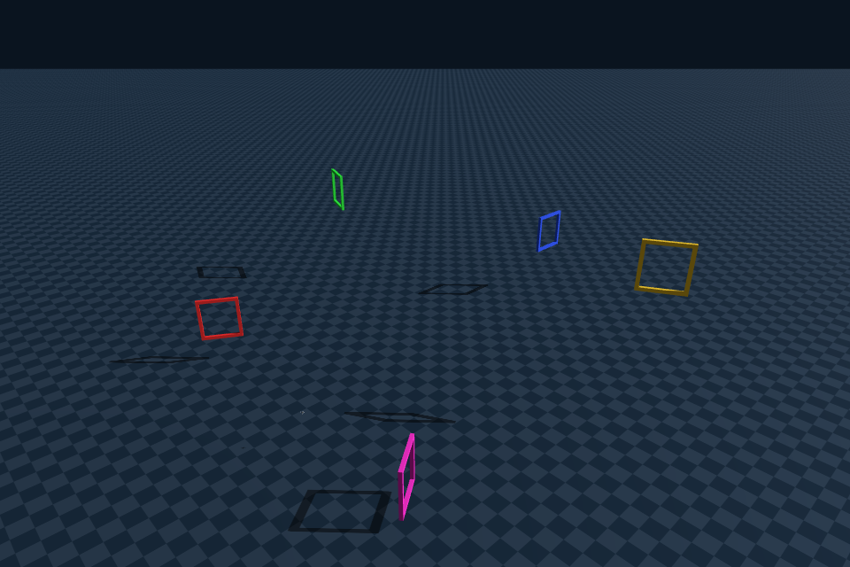
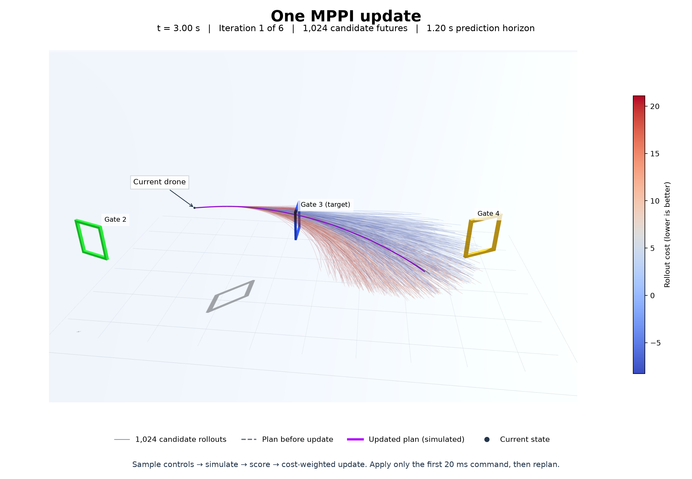
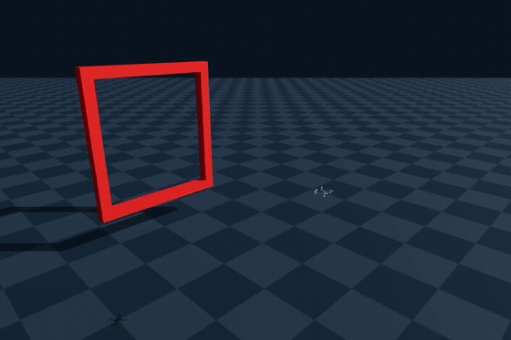
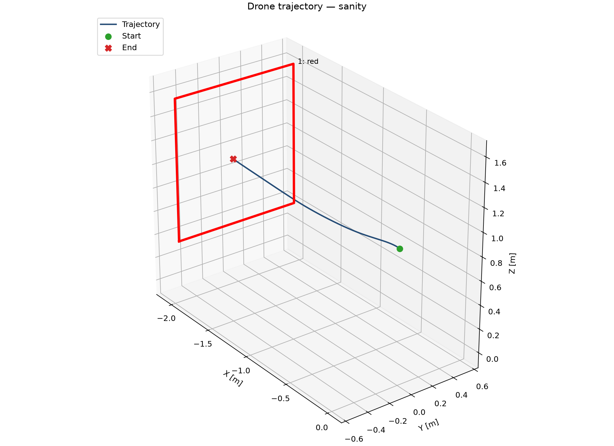
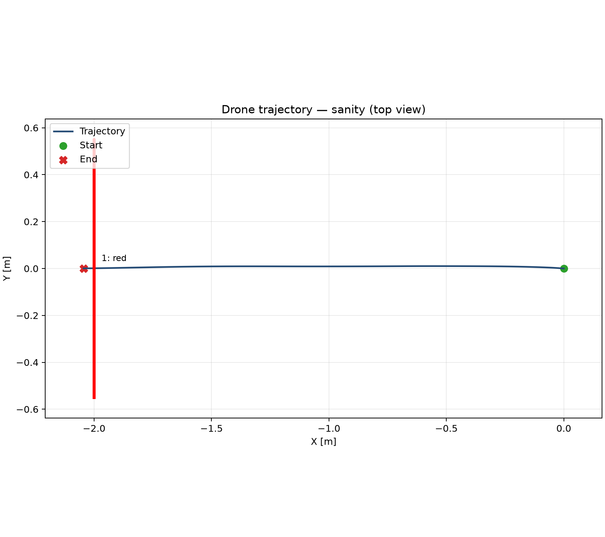
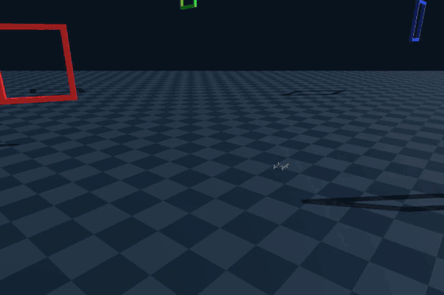
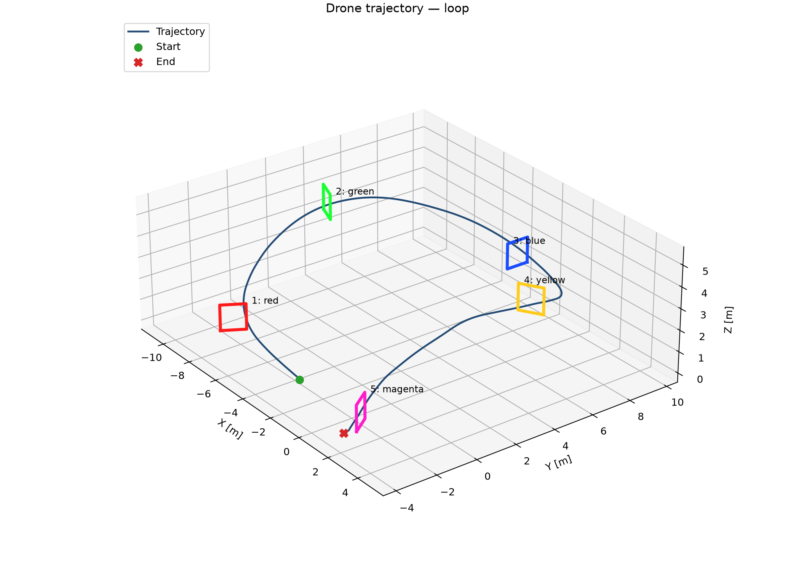
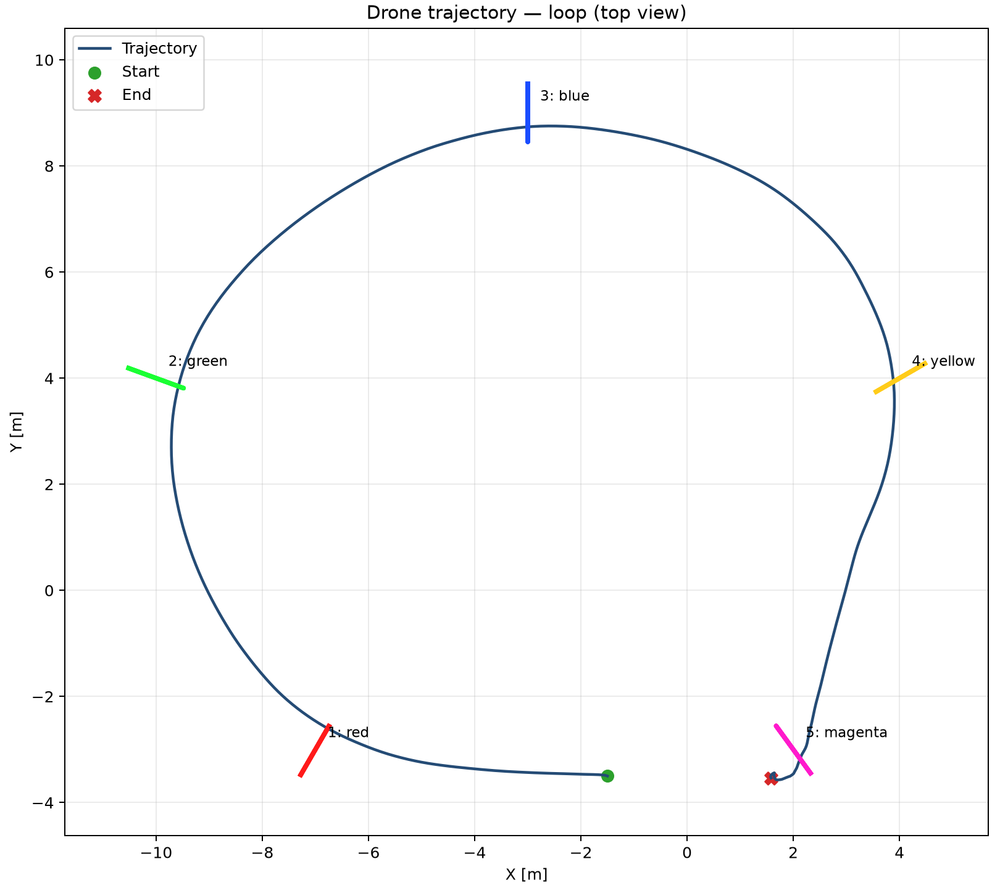

# Model Predictive Control

PIDs are an elegant solution to the problem of control. They allow us to steer delicate systems smoothly and efficiently. But they are not the only way to go about control. In this lab we will explore [MPC](https://en.wikipedia.org/wiki/Model_predictive_control) (Model Predictive Control). MPC is a broad category of algorithms that use a model of the process we are working with as a source of feedback to create and optimize control plans. It allows for optimizing a plan in accordance with the anticipated future of the system—something that PIDs cannot do. The problem, however, is that we need to create a model. Depending on the system we are working with, creating the model can range from being trivial to nearly impossible. Additionally, any inaccuracies in our model may carry over to real-world decision-making with potentially catastrophic consequences.

## Model Predictive Path Integral

In this lab we will work with one type of MPC—[MPPI](https://acdslab.github.io/mppi-generic-website/docs/mppi.html) (Model Predictive Path Integral). MPPI is a conceptually simple algorithm that can optimize an arbitrary cost function in an arbitrary environment. We do not assume that the environment is differentiable, which is a major advantage; instead, we rely on raw computational power to stochastically sample possible outcomes of each action, score them, and then choose the ones leading to the most desirable outcomes.

### The cost (reward) function

For the optimization to work, we need a way to score a given state of the environment. We will implement a reward function that gives high values for desirable states and low values for states we want to avoid. It is important to realize that this function will be the only source of truth about what is "good" and "bad" for the algorithm—whatever biases, values, and goals we put in it will be reflected in the control. It is the same as in reinforcement learning—the algorithm may find ways to cheat by exploiting loopholes in the reward function, so be careful! It is also important to note that MPPI **minimizes** the cost function, so we will use negative reward as the cost.

### Parallel sampling

At any given step, MPPI will sample a large number of action **sequences** and then, in parallel, run each sequence in a separate environment instance. For the algorithm to work, we need a sufficient number of samples, and each sample has to be run for some time in simulation to notice not only immediate, greedy results but also more long-term consequences. Because of that, it is important to use a simulation that allows for parallelism out of the box and thus runs much faster with multiple samples. We will use [Genesis](https://genesis-world.readthedocs.io/en/latest/user_guide/getting_started/hello_genesis.html).

## Setup

We will work with a drone similar to the one from the 2nd homework. Our goal is to go through a series of gates, in order, without crashing, stopping to hover in place after the last gate. MPPI will be given direct control of the drone's motors; there will be no PID, stabilization, etc.

The environment, drone control, and some utility functions are in [backend/](backend/). You do not need to understand everything about them, but it is good to take a look. We are working with the Genesis simulator, which is similar to MuJoCo but does differ in a couple of places. The most important change is that since Genesis is parallelizable, each input to and output from the environment functions is a torch array, where the first dimension is the number of concurrent simulations. This allows us to run it on a GPU for much quicker execution (`--backed gpu`). Using CPU still works, but it can take a bit longer, especially on longer tracks, with more parallel environemnts.



### The reward function implementation

Our reward function is quite complex, since we need to make sure that the drone is not only going to the correct gate but also not colliding with anything, going too fast, or flying in an uncontrollable way. Filling in the gaps in [rewards.py](rewards.py) is your first task. The reward function is broken down into multiple components, so it is easier to understand and implement. Then, those components are weighted and summed to get the final reward function we want to optimize. Because of instabilities in simulation, it is important to check if what we calculate in rewards is finite!

### MPPI implementation

Your second task is to finish the implementation of the MPPI algorithm itself in [mppi.py](mppi.py). Follow the comments in the code to finish the implementation. You may find it useful to familiarize yourself with [generic MPPI pseudocode](https://acdslab.github.io/mppi-generic-website/docs/mppi.html).

<a href="assets/media/mppi-rollouts.png"></a>

### Run your implementation

Once everything is working, you can run:

```sh
uv run run.py --track sanity
```

Each run saves a video, JSON metrics, an NPZ trajectory, and 3D/top-down plots in a new directory under `outputs/`; the program prints its location.

This is a simple environment with a single gate for the drone to pass through. It will also create a video of the drone flight for you to inspect; it should look something like this:

<a href="assets/media/sanity-flight.mp4"></a>

You can also inspect the path of the drone on the plots.

| 3D trajectory | Top-down trajectory |
| :---: | :---: |
| <a href="assets/media/sanity-trajectory-3d.png"></a> | <a href="assets/media/sanity-trajectory-2d.png"></a> |

Once the drone passes the gate on the first track, you can also run:

```sh
uv run run.py --track straight
```

```sh
uv run run.py --track loop
```

These are more elaborate racing tracks. Before running the last one, be careful: depending on your machine and whether you have a GPU or not, it may take tens of minutes to run it. Here is an example video of the hardest track:


<a href="assets/media/loop-flight.mp4"></a>

| 3D trajectory | Top-down trajectory |
| :---: | :---: |
| <a href="assets/media/loop-trajectory-3d.png"></a> | <a href="assets/media/loop-trajectory-2d.png"></a> |


## Numerical integration and timestep size

MPPI relies on a model to predict the future motion of the drone. To compute these trajectories, the simulator uses numerical integration: it approximates continuous dynamics by advancing the state in discrete time steps. The timestep affects both the accuracy and the computational cost of these predictions.

### Forward Euler integration

Let $x(t)$ represent the state of a system evolving according to

$$\dot{x} = f(x, u)$$

where $u$ is the applied control. The Forward Euler integration scheme approximates the next state as

$$x_{i+1} = x_i + \Delta t\,f(x_i, u_i)$$

Here, $\Delta t$ is the timestep: we evaluate the current rate of change and assume it remains constant over that interval. For a mechanical system, the state includes positions and velocities, and forward dynamics determines the accelerations produced by the applied forces. Numerical integration then advances the state in time. Genesis handles integration internally; Forward Euler illustrates the basic idea rather than specifying the integrator used by Genesis.

### Does the timestep matter in our simulation?

A larger integration step means fewer updates per simulated second, which can make simulation faster, but generally increases numerical error. With sufficiently large steps, the simulated motion can become inaccurate or unstable. For our drone, this affects the predicted trajectories and can change whether gate and ground checks register a failure.

In [backend/drone_env.py](backend/drone_env.py), `EnvConfig` separates three settings:

- `physics_dt`: the simulated time advanced by one scene step.
- `physics_substeps`: the number of internal integration steps within a scene step.
- `control_steps`: the number of scene steps for which a motor command is held.

The internal integration step is `physics_dt / physics_substeps`, while the controller interval is `physics_dt * control_steps`. With the defaults, these are 5 ms and 20 ms, respectively.

Repeat the straight-track run above with `--substeps 4`, `--substeps 2`, and `--substeps 1`. Keep `physics_dt`, `control_steps`, the random seed, and the MPPI parameters unchanged. This changes the integration resolution while preserving the controller frequency and prediction horizon in seconds. Compare runtime, gate completion, simulated flight time, and the saved trajectories.

- How much computation do you save by increasing the integration step?
- Does successfully passing all gates imply that the simulated trajectory is accurate?
- MPPI replans after each observation: can this feedback compensate for numerical error?
- How could replaying the same motor commands with different timesteps help distinguish integration error from changes in the controller's decisions?
